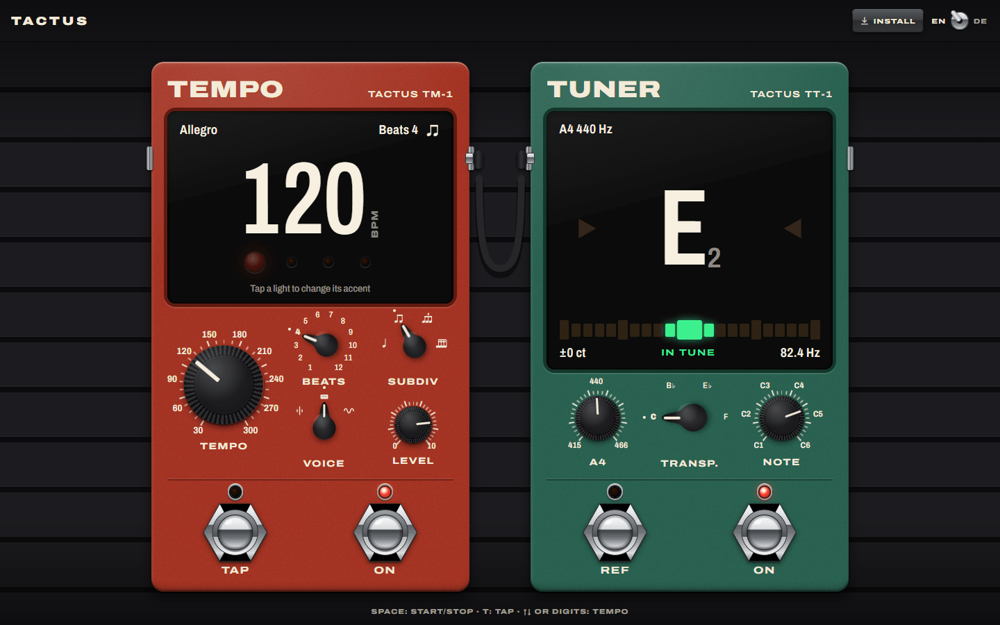
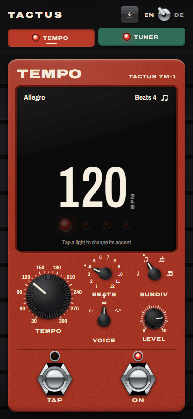
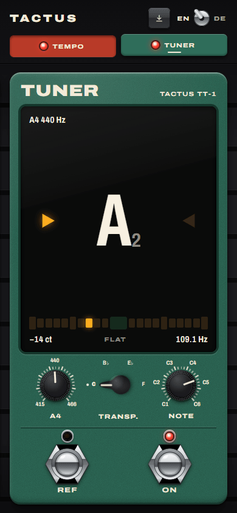

# Tactus

**A metronome and a chromatic tuner, built like a pedalboard.** Each tool is an enamel stompbox with a glass display, real knobs and footswitches you can hit with a thumb. It installs like an app, **works fully offline**, needs no account and sends nothing anywhere.



<table>
  <tr>
    <td width="50%" align="center"></td>
    <td width="50%" align="center"></td>
  </tr>
  <tr>
    <td><b>Tempo.</b> Turn the big knob, tap TAP in time, or tap the number and type it. Tap a beat light to accent it or silence it. The ON switch sits where your thumb is.</td>
    <td><b>Tuner.</b> Play one note. The arrow and the light show which way to go; the wide centre bar turns green when you are in tune. REF plays a reference note you pick with the NOTE knob.</td>
  </tr>
</table>

<sub>Screenshots of the real app; the tuner was fed test tones.</sub>

## Install it

Tactus is a web app you can install, so it sits on your home screen or in your dock and opens in its own window, without browser bars.

| Device | How |
|---|---|
| **iPhone / iPad** (Safari) | Share button → **Add to Home Screen** |
| **Android** (Chrome) | Menu ⋮ → **Install app** (or the install banner) |
| **Desktop** (Chrome, Edge) | The **Install** plate in the Tactus header, or the install icon in the address bar |

Settings (tempo, beats, accents, A4, transposition, language) are kept on the device.

## Works offline

After the first visit, everything Tactus needs is on your device: the app, the font, the sounds (synthesised, no audio files) and the pitch detector. It works in airplane mode, in a rehearsal cellar without signal and on stage. Playing never needs the network (the only requests are occasional checks for a new version), and the microphone signal is analysed on the device and never leaves it.

When a new version is published, it downloads quietly in the background and an amber **Update ready · Reload** plate appears in the header. Nothing reloads by itself, so a running metronome is never cut off; tap the plate when it suits you.

## What it does

**Tempo** (metronome)
- 30–300 BPM, with the Italian tempo term (Andante, Allegro …) in the display
- 1–12 beats per bar; each beat accented, normal or silent
- Quarter, eighth, triplet and sixteenth subdivisions
- Three sounds (click, wood, beep) and a level knob
- Tap tempo; or type a tempo: tap the number, double-tap the knob, or type digits on a keyboard
- Rock steady: every click is placed on an exact audio sample inside the audio engine, so timing holds with the screen off or the app in the background, and the screen stays awake while it runs

**Tuner**
- Chromatic, from low B on a 5-string bass (31 Hz) upwards
- Reference pitch A4 from 415 to 466 Hz (440, 442, 443 …)
- Transposition for instruments in B♭, E♭ and F
- Reference tone from C1 to C6
- Readable from the music stand: big note, arrows and a light bar that do not rely on colour alone

**Everywhere**
- English and German, following the device (switch at the top right); German uses German note names (Cis, Es, B, H)
- Keyboard: Space start/stop, T tap, ↑/↓ tempo (Shift ±10), digits type a tempo; every knob works with arrows, Page Up/Down, Home/End and the mouse wheel

## Develop

Tactus is a static web app: Vite and TypeScript, no UI framework, with the pitch detector in Rust compiled to WebAssembly.

```sh
npm install
npm run dev          # http://localhost:5173
```

Setup, scripts, testing the offline build, hosting your own copy and how the audio engine works: **[docs/DEVELOPMENT.md](docs/DEVELOPMENT.md)**.

## Docs

- [PRODUCT.md](PRODUCT.md): who it is for and why
- [DESIGN.md](DESIGN.md): the visual system
- [docs/DEVELOPMENT.md](docs/DEVELOPMENT.md): development guide and technical details

Font: Archivo (SIL Open Font License), bundled.
